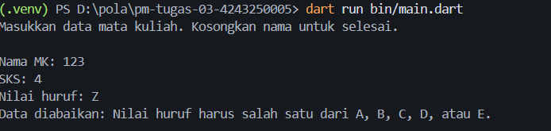

# Tugas Rutin 3 — Kalkulator IP Semester

**Nama:** Christian Nicholas Sinaga  
**NIM:** 4243250005  
**Kelas:** PSIK 24C

## Deskripsi

Program console menerima mata kuliah satu per satu sampai nama dikosongkan.
SKS yang valid adalah 1–6 dan nilai huruf A–E. Data dengan input tidak valid
diabaikan, lalu program mencetak Kartu Hasil Studi dengan IP semester,
predikat, dan daftar mata kuliah yang memiliki SKS kurang dari 2.

## Menjalankan dan memeriksa

Jalankan dari folder proyek:

```powershell
dart pub get
dart run bin/main.dart
dart analyze
dart test
```

Contoh masukan (baris kosong pada Nama MK mengakhiri input):

```text
Pemrograman Mobile
3
A
Jaringan Komputer
tiga
B
Statistika
2
B
Etika Profesi
2
D

```

## Closures, higher-order functions, dan error handling (100–200 kata)

Di `lib/khs.dart`, fungsi `hitungIp` menggunakan `fold` untuk mengakumulasi
jumlah SKS dan total bobot nilai secara berbobot. Callback pada `fold` adalah
closure: fungsi kecil yang menerima nilai akumulasi dan mata kuliah berikutnya.
Pada `cetakKhs`, `where` memakai closure predikat untuk memilih mata kuliah
dengan SKS kurang dari dua. Jika opsi `urutkan` bernilai benar, `sort`
menerima closure pembanding yang mengurutkan bobot tertinggi lebih dahulu.
Karena fungsi-fungsi tersebut menerima fungsi lain sebagai argumen, `fold`,
`where`, dan `sort` menjadi contoh higher-order functions. Validasi input
dilakukan oleh `validasiMataKuliah`; SKS bukan angka 1–6 atau nilai di luar A–E
menyebabkan `FormatException`. Fungsi `main` menangkap exception tersebut,
menampilkan alasan data ditolak, lalu melanjutkan input berikutnya tanpa
menghentikan aplikasi. Dengan demikian, satu kesalahan tidak menghilangkan
data mata kuliah lain yang sudah valid.

## Bukti tangkapan layar

Ambil satu tangkapan layar terminal yang menampilkan sekurangnya satu input
tidak valid, pesan bahwa data diabaikan, data valid lain, dan KHS yang tercetak.
Simpan sebagai `screenshots/khs-input-invalid.png`, lalu pastikan file itu
termasuk di repository sebelum dikumpulkan.



## Penggunaan AI

AI digunakan sebagai bantuan untuk menyusun implementasi, kasus uji, dan draf
README. Program diperiksa dengan `dart analyze` dan `dart test`.

## Pengumpulan

Buat repository GitHub publik bernama `pm-tugas-03-4243250005` dan unggah
repository dengan sedikitnya tiga commit. Kirim tautan repository melalui LMS
UNIMED sesuai instruksi pengumpulan.
